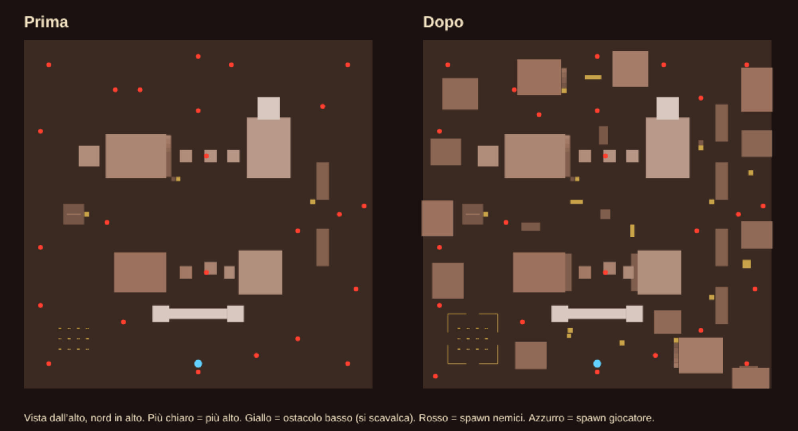

# High Noon Hell — Game Design

Documento vivo: raccoglie le decisioni di design prese finora e le domande ancora aperte.
Le decisioni marcate **[DECISO]** sono state concordate; **[DA DECIDERE]** sono aperte.

---

## 1. Visione

Boomer shooter western infernale per browser, da giocare con gli amici.
**Il movimento è il cuore del gioco**: correre, scivolare, saltare sui muri e sfruttare la
verticalità deve essere la cosa più forte che puoi fare, non solo la più divertente.

### Pilastri
1. **Movimento come potere** — chi si muove bene uccide di più, sopravvive di più, guadagna di più.
2. **Pressione da ogni direzione** — ogni nemico rende scomoda una posizione diversa: nessun posto è sicuro a lungo.
3. **Leggibilità** — ogni minaccia è annunciata (suono, luccichio, proiettile visibile): morire deve sembrare colpa tua, non del gioco.
4. **Atmosfera** — luci, nebbia, particelle e cielo curati; due ambientazioni: High Noon e High Midnight.

### Cosa vogliamo evitare
- Il "camperare" fermo su un tetto.
- Il loop ripetitivo "corri, girati, spara, ripeti" dei survivor-like con nemici che vanno solo dritti.

---

## 2. Anti-camping: il meter dello Stile [DECISO]

Niente punizioni dirette per chi sta fermo (per ora). Il giocatore si muove perché **conviene**.

### Rank dello stile
Barra con rank a lettere, convenzione classica dei beat-'em-up / action (DMC, ULTRAKILL…):

| Rank | Nome (proposta, a tema) |
|------|-------------------------|
| D    | Dusty                   |
| C    | Cowpoke                 |
| B    | Bandit                  |
| A    | Desperado               |
| S    | Sharpshooter            |
| SS   | Showdown                |
| **HN** | **HIGH NOON** (rank massimo, col nome del gioco) |

Le lettere sono una convenzione di genere; per differenziarci usiamo **nomi western** e un rank
finale unico, "HIGH NOON". [DA DECIDERE: nomi definitivi]

### Cosa fa salire lo stile
- Velocità alta mantenuta, tempo in aria, catene di slide-hop.
- Wall jump, uccisioni in aria o durante uno slide.
- **Varietà**: armi diverse, nemici diversi, modi diversi. Ripetere la stessa azione rende sempre meno.
- Schivate ravvicinate di proiettili (bonus "near miss").

### Cosa lo fa scendere
- Il tempo (decadimento costante, più veloce ai rank alti).
- Stare fermi o lenti: il decadimento accelera.
- Subire danni: perdi punti di stile.

### A cosa serve
- **Moltiplicatore** su anime/XP raccolte e punteggio.
- Bonus di danno ai rank alti.
- [DA DECIDERE] Eventuale bonus di drop della salute ai rank alti.

### Risorse dall'aggressività [PROPOSTO]
- Niente rigenerazione della salute: la salute cade dai nemici uccisi.
- Munizioni sparse per la mappa: chi resta fermo le finisce.

---

## 3. Nemici

Regola d'oro: **i nemici attaccano lo spazio, non solo il giocatore**. Ogni tipo mette una
pressione diversa. Proiettili nemici quasi sempre **lenti e visibili**; colpi istantanei solo
con un chiaro preavviso.

| Nemico (provvisorio) | Ruolo | Pressione |
|---|---|---|
| **Ghoul** | Carne da cannone (ispirato agli zombie di CoD Zombies): cammina verso di te, **scavalca gli ostacoli bassi e aggira quelli alti**; in futuro si arrampicherà | A terra non sei mai al sicuro; un muretto non basta |
| **Segugio infernale** | Balzi lunghi e precisi, anche su piattaforme | Devi muoverti continuamente |
| **Avvoltoio** | Volante, gira in cerchio e picchia in picchiata | Raggiunge ogni tetto, obbliga a guardare in alto |
| **Malocchio** [FATTO] | Occhio-pipistrello volante: orbita attorno a te a distanza (10 m, 5 m più in alto) e spara proiettili lenti. **Pupilla = punto critico** (×3, come la testa del ghoul) | Il movimento diventa difesa; obbliga a guardare in alto e a mirare con precisione |
| **Fuoco fatuo** | Volante a distanza, proiettili lenti (forse superato dal Malocchio) | Il movimento diventa difesa |
| **Pistolero scheletro** | A distanza, colpo istantaneo **annunciato** (luccichio + click) | Punisce chi sta fermo in vista, premia chi rompe la linea di tiro |
| **Dinamitardo** | Lancia dinamite ad arco, lascia fiamme | Nega zone: ti costringe a spostarti |
| **Toro / Bruto** | Lento, corazzato, carica devastante | Si schiva di lato o si scavalca |
| **Boss** | Pattern complessi, ogni tot ondate | Picco di intensità |

Stile: **sprite 2D** (tipo Doom), coerenti con il resto.

### Navigazione [FATTO]
- **Grafo di navigazione** generato automaticamente dai box del livello (`src/sim/nav.ts`):
  nodi ogni 1,5 m su ogni superficie + link "cammina / salta / cadi / arrampicati".
  I ghoul **si arrampicano sui muri fino a 15 m** e **usano gli sfiatatoi** (solo quando lo scelgono):
  nessun tetto è sicuro (campanile compreso).
- **Flow field**: una sola ricerca (Dijkstra) dal giocatore, condivisa da tutti i ghoul.
- Tasto **N** in gioco: mostra il grafo.
- **Inseguimento e accerchiamento**: quando un ghoul ti **vede** sul suo stesso livello (entro 30 m),
  smette di seguire il grafo e corre **dove stai andando** (intercettazione, fino a 1,5 s di anticipo),
  ognuno puntando qualche metro **di lato** (fino a 5 m, lato e distanza dipendono dall'id): l'orda si
  apre a ventaglio e ti chiude da più direzioni invece di metterti in fila dietro. Da vicino (5 m)
  torna a puntarti dritto. Distanza minima tra ghoul: 1,4 m (era 1).
  Col bot di prova (giro in tondo, ondata 30): ghoul entro 6 m in media da 0,5 a ~4.
- I volanti usano uno steering 3D semplice che evita gli ostacoli.

---

### Danni e salute: la regola dei breakpoint [DECISO]
Gioco **aim-intensive** che premia il movimento: niente nemici "spugna".
- **Si progetta in colpi per uccidere**, non in punti vita: il giocatore sente "2 colpi", non "130 HP".
  La salute si sceglie in base ai breakpoint (le soglie dove cambia il numero di colpi).
- Revolver **50 danni**, **testa ×3** (super premiata: segnalino dorato, suono dedicato, testa che
  esplode, +50 punti sull'uccisione).
- **Salute dei ghoul a gradini lenti** (ogni 10 ondate):

| Ondate | Salute | Corpo | Testa |
|---|---|---|---|
| 1–9 | 50 | 1 colpo | 1 colpo |
| 10–19 | 100 | 2 colpi | 1 colpo |
| 20–29 | 150 | 3 colpi | 1 colpo |
| 30+ | 200 | 4 colpi | 2 colpi |

  La salute **si ferma a ×4** (`waveHealthMaxMultiplier`): prima continuava a salire (all'ondata 50
  un ghoul aveva 300 HP e un Malocchio 600, cioè spugne). Il Malocchio ha la stessa tabella del ghoul.

- La difficoltà delle prime ondate viene da **quantità, velocità, direzioni, tipi di nemico**;
  la salute alta arriva solo molto tardi. Nemici resistenti = **miniboss** (eventi, non la norma).
- **Hitbox generose, separate dal collider** [DECISO]: la scatola che urta i muri (stretta, per
  passare nei vicoli) non è quella che prende i colpi. La hitbox copre **tutto lo sprite**: ghoul
  1,0 × 2,0 m (il collider è 0,7 m), Malocchio un cubo di 1,3 m attorno all'occhio (prima 0,8 m),
  pupilla con raggio 0,25 m (prima 0,15). Regola: un colpo che tocca visibilmente il disegno deve
  contare. Tasto **H** per vederle.
- **Malocchio**: **stessa salute del ghoul** (50, stessi gradini), quindi stessi colpi per uccidere:
  1 colpo nelle ondate 1–9, dalla 30 4 al corpo o 2 nella pupilla. La sua difficoltà è colpirlo
  (piccolo, in alto, in movimento), non la resistenza. Il critico si calcola
  come distanza tra la traiettoria del proiettile e il centro dell'occhio (lo sprite guarda
  sempre verso di te, quindi il centro visto da te è la pupilla): raggio 0,15 m.
- **Sparo del Malocchio**: ogni ~2,5–3,5 s, solo se ti vede (entro 30 m). **Preavviso di 0,7 s**
  (pupilla dilatata, iride sempre più accesa, sibilo crescente; intanto rallenta: è il momento
  migliore per colpirgli la pupilla). Palla di fuoco a **12 m/s** (tu corri a 8+), 15 danni,
  **mirata dove sarai** (tiro d'anticipo, `eyebatLeadFactor` 0,9): se continui dritto o in tondo
  alla stessa velocità ti prende. Per schivarla devi **cambiare direzione** dopo il preavviso
  (salto, slide, inversione). Prima mirava dove eri: bastava muoversi, e al playtest girare in
  tondo rendeva immortali (0 colpi su 190 col bot di prova).
- **Ghoul: artigliata e balzo.** L'artigliata (20 danni) non lo ferma più: continua a camminare
  al 60% della velocità mentre colpisce, quindi passargli accanto non è gratis. Tra **2 e 6 m**,
  con la linea libera, **balza**: 0,45 s accovacciato a braccia alzate con uno **stridio che sale**
  (il preavviso), poi un salto basso e veloce (fino a 13 m/s, ~0,4 s in aria, preavviso 0,45 s) mirato **dove sarai**
  all'atterraggio. Ti ferisce se ti tocca in volo (20 danni). Atterrato resta **a terra 0,6 s**:
  è il momento di punirlo. Ricarica di 3–4,5 s. Resta un nemico che punisce le distrazioni:
  per chi lo vede arrivare è schivabile (salto, slide di lato).
- **Calcio (melee)** [FATTO, da tarare]: F o tasto destro. Colpisce **tutto** in un cono davanti
  (1,6 m, ±45°), 25 danni (mezzo ghoul base: è uno strumento, non l'arma principale), e **spinge via**
  (13 m/s in avanti, 5 m/s in alto): il ghoul vola via, interrompe artigliata e balzo, e resta a terra
  0,5 s. Si può calciare mentre si ricarica. Ricarica di 0,55 s.
- **Niente rigenerazione della salute.** [DA DECIDERE] drop casuali dei nemici (medikit o simili).

## 4. La mappa [DECISO: cittadina all'aperto]

**Una cittadina fantasma western sprofondata all'inferno.** Non deve essere realistica: va bene
un tocco **distopico e assurdo** — torri altissime collegate da ponti, edifici enormi che non
avrebbero senso, strutture sospese.

Possibili luoghi: strada principale, saloon, chiesa con campanile, ufficio dello sceriffo,
torre dell'acqua, ingresso di una miniera, binari con vagone, cimitero, forca.

### Tre livelli di altezza
1. **Strade** — spazio ampio, tanti nemici, munizioni. Il piano di battaglia.
2. **Tetti e balconate** — raggiungibili con salti e wall jump; al riparo dalle orde a terra
   ma **esposti** a volanti e pistoleri.
3. **Punti alti** (campanile, torri, ponti sospesi) — raggiungibili con catene di wall jump
   (e in futuro con il lazo). Contengono **ricompense temporanee**: si visitano, non si abitano.

### Stato attuale: greybox (`src/levels/town.ts`)
Cittadina 92 × 92 m chiusa da un canyon. Saloon (tetto 7,3 m, balconata a 3 m), chiesa (9,3 m)
con campanile (22 m), sceriffo (5,3 m), banca (8,3 m), torre dell'acqua (8 m), torri gemelle
(14 m) unite da un ponte sopra Main Street, piattaforme sospese tra i tetti, forca, cimitero,
vagoni. 4 sfiatatoi di vapore. Tutti i percorsi sono stati verificati in simulazione.

### Passata "corpo a corpo" (dopo il playtest dell'ondata 50) [FATTO]
Il playtest ha mostrato che la mappa era **troppo vuota**: interi quadranti di 20×20 m di terra
nuda e strade larghe 20 m, quindi bastava correre in tondo. Ora:
- **Edifici nuovi nei quadranti vuoti**: hotel (con scala di casse, tetto 5,3 m), impresario,
  stalla, deposito ferroviario, casa, bagni pubblici, ufficio del telegrafo, armeria, magazzino (scala
  di casse, tetto 6,3 m), ingresso della miniera. La cittadina diventa una **griglia di strade e
  vicoli** (2,5–10 m) invece di una pista.
- **Linea del treno**: 4 vagoni in fila lungo x = 30, un muro con tre passaggi stretti (5–7 m).
- **Tettoie aperte** (forgia, segheria) e **portici** davanti a sceriffo e banca: ti nascondono
  dai Malocchi (serve la linea libera per sparare), ma non dai ghoul.
- **Ostacoli bassi in strada** (abbeveratoi, casse, diligenza, pozzo, carro, staccionata del
  cimitero): sotto 1 m li scavalcano tutti. Chi salta passa sopra mantenendo la velocità, chi corre
  a terra ci sbatte. Col bot di prova: girando in tondo **senza saltare** ci si incastra (velocità
  media 5,8 m/s invece di 8) e i ghoul ti raggiungono; **saltando** si subisce circa 4 volte meno danno.
- Tutti i vecchi percorsi verso l'alto restano invariati; i punti di spawn sono stati ricontrollati.
- Costo: da ~700 a ~840 draw call nella vista più pesante (+21%). Se pesa: static batching (§9).

### Regole pratiche emerse (vincoli del movimento attuale)
- **Salto massimo ≈ 1,17 m**: gradini e scalini al massimo **1 m**.
- **Salto in corsa ≈ 5,6 m** di distanza: gap tra piattaforme ≤ 3–4 m per stare comodi.
- **Wall jump in stile Apex**: spinta forte verso l'alto, piccola spinta via dal muro e
  **velocità lungo il muro** nella direzione in cui guardi.
  - Guardando il muro e concatenando i 3 wall jump si sale di **≈4,5 m** su una parete singola.
  - Guardando lungo il muro il wall jump è uno slancio in avanti (+2,5 m/s).
  - Oltre i ~4,5 m servono sfiatatoi, percorsi a gradini o (in futuro) il lazo.
- **Bunny hop facilitato**: finestra di 0,12 s dopo l'atterraggio senza attrito, e ogni hop
  riuscito dà velocità extra che cala con la velocità (8 → 13 m/s in ~8 hop tenendo solo W).
  Nessun tetto rigido.

### Principi
- **Niente vicoli ciechi**: ogni percorso è un anello.
- **Linee di flusso**: percorsi che permettono di concatenare slide, salti e wall jump senza fermarsi.
- **Sfiatatoi di vapore** steampunk che lanciano in alto (jump pad).
- **Punti di aggancio** per il futuro lazo: pali, insegne, travi.

---

## 5. Gameplay loop

### Struttura della partita [FATTO: ondate stile CoD Zombies]
Ondate numerate (`src/sim/waves.ts`), sempre più dure, 8 s di pausa tra una e l'altra,
annunciate dalla campana della chiesa. Alla morte: riepilogo (ondata, uccisioni, punti) e
si ricomincia dall'ondata 1.

**Composizione casuale a budget [DECISO]**: niente ondate scritte a mano. Ogni tipo di nemico ha
un **peso** (quanto è pericoloso), ogni ondata un **budget** di peso; a ogni spawn si pesca un tipo
a caso tra quelli che il budget residuo si può permettere. Stesso budget, mix diverso in ogni
partita. Il ghoul pesa **1**, il Malocchio **2** e compare **dall'ondata 3** (`eyebatFromWave`):
le prime due ondate sono di soli ghoul, per scaldarsi. Un futuro bruto potrebbe pesare 5.
Il caso usa un generatore con **seed** (deterministico: stesso seed = stessa partita).

| Ondata | Budget (peso) | Corridori (tra i ghoul) | Salute (ghoul = Malocchio) |
|---|---|---|---|
| 1 | 6 | 0 | 50 |
| 4 | 13 | ~10% | 50 |
| 8 | 27 | ~50% | 50 |
| 10 | 36 | 60% | 100 |
| 20 | 98 | ~73% | 150 |
| 35+ | 247+ | 90% | 200 |

- Peso vivo insieme: 6 + 2·ondata (**max 40**, raggiunto all'ondata 17; prima era 24, raggiunto
  all'ondata 9, e da lì la pressione non cresceva più). La salute di tutti i nemici sale a gradini
  ogni 10 ondate, fino a ×4. Intervallo di spawn: da 2 s a 0,5 s.
- **Corridori** (dall'ondata 4): 5,4 m/s invece di 3,6, **occhi rossi**. +10% a ondata fino al 60%
  all'ondata 9, poi sempre più lentamente fino al **90% al picco**.
- **Pressione** (`wavePressure`): 0 all'ondata 1, sale fino a 1 all'**ondata 35** (`wavePeak`), poi
  resta lì. Al picco i Malocchi sparano ogni 1,5 s invece di 2,5 e i ghoul balzano ogni 1,5 s invece
  di 3. Il picco è attorno a 30–40 perché l'ondata 50 è già "late game" per un giocatore molto bravo.
- Bot di prova (gira in tondo, **non spara mai**: un limite superiore, un giocatore vero uccide):
  danni al minuto ghoul + palle di fuoco ≈ 340 (ondata 2), 500 (5), 780 (10), 1100 (35+).
  Prima di questi cambi: **0 a qualsiasi ondata**.
- **Dove nascono i nemici** (stile CoD Zombies / Left 4 Dead): 24 punti di spawn sparsi per tutta la
  cittadina (non solo ai bordi). A ogni spawn si preferisce un punto **fuori vista** (un muro tra
  i tuoi occhi e il punto), tra 15 e 40 m, e nel 70% dei casi **davanti a te** (entro 60° dalla
  direzione in cui corri). Girare in tondo non vuol più dire trascinarsi l'orda dietro: ti porta
  dritto nella prossima.
- **Punteggio** stile CoD: 10 per colpo, 100 per uccisione.
  [DA DECIDERE] cosa si compra con i punti (armi, potenziamenti, "santuari" sulla mappa).

Elementi indipendenti dalla scelta:
- I nemici lasciano **anime** (XP/valuta) da raccogliere passandoci sopra; svaniscono dopo
  qualche secondo → altro motivo per muoversi.
- **Potenziamenti** che includono anche il **movimento** (wall jump extra, doppio salto, scatto,
  slide più lungo, lazo più lungo).
- **Eventi sulla mappa** che spostano il giocatore (altari da attivare, forzieri sui punti alti).

[DA DECIDERE] Tra un'ondata e l'altra: negozio? scelta di potenziamenti? macchinette tipo
"Perk-a-Cola" sparse per la mappa (a tema: santuari / altari del diavolo)?

---

### Bersagli d'acciaio [DECISO: tenerli]
I bersagli di prova (piatti d'acciaio su palo, 3 colpi, si rialzano) restano: serviranno per un
futuro **poligono di tiro / tutorial**.

## 6. Armi (bozza)

- **Revolver** — preciso, hitscan, "fanning" (raffica rapida col tasto destro).
- **Canne mozze** — rosa di pallini, contraccolpo che ti spinge (anche come tecnica di movimento).
- **Lazo / rampino** — mobilità (aggancio a punti della mappa) e utilità (tirare a sé i nemici?).

---

## 7. Ordine di sviluppo

1. **Mappa in greybox** — la cittadina fatta di box, per provare percorsi e verticalità col movimento attuale.
2. **Revolver** — viewmodel segnaposto, sparo hitscan, feedback.
3. **Due nemici prototipo**: avvoltoio (volante) e ghoul che salta (grafo di navigazione).
4. **Loop minimo**: ondate, anime, salute dalle uccisioni, meter dello stile.
5. Altri nemici, potenziamenti, lazo, boss.

---

## 8. Domande aperte

- Struttura definitiva della partita (ondate vs run a tempo) e cosa succede tra le ondate.
- Nomi definitivi dei rank di stile.
- Morte: si ricomincia da capo? Progressione persistente tra le partite?
- Multiplayer co-op alle orde (in futuro): come si condivide lo stile?

---

## 9. Prestazioni: regole e ottimizzazioni rimandate

**Regola: prima misura, poi ottimizza.** Le ottimizzazioni complicano il codice: si fanno solo
quando una misura (l'indicatore in basso a sinistra: fps, ms di simulazione e di disegno,
draw call) mostra che servono, e solo nel punto che costa. Eccezione: le scelte corrette per
costruzione che non complicano nulla (es. il limite di voci per i versi dei nemici).

### Misure (simulazione, novembre 2026)
| Ghoul | Costo per tick | Quota di un fotogramma a 60 fps |
|---|---|---|
| 100 | 0,24 ms | 1,4% |
| 200 | 0,8 ms | 5% |
| 400 | 2,6 ms | 16% |
| 800 | 10,4 ms | 63% |

### Ottimizzazioni pronte all'uso (quando servono)
| Ottimizzazione | Quando farla | Cosa risolve |
|---|---|---|
| **Static batching**: unire tutte le mesh statiche del livello e dei props in poche mesh (una per materiale) | se le draw call pesano: oggi ~470 con 4 ghoul, quasi tutte dal livello e dai props (ogni pezzo è un oggetto, ×2 per le ombre) | costo per-oggetto della geometria che non si muove mai |
| **Instancing degli sprite** (un'unica draw call per tutti i ghoul) | draw call > ~300 o fps che calano con molti nemici | costo per-oggetto del disegno (oggi 2 draw call per ghoul: corpo + ombra) |
| **Griglia spaziale** per la separazione | > ~200 nemici insieme | costo O(N²) della separazione (ogni ghoul controlla tutti gli altri) |
| **Ombre "a macchia"** per i nemici lontani | se le ombre pesano (molti nemici visibili) | ogni nemico viene disegnato 2 volte (scena + shadow map) |
| **IA a frequenza ridotta** per i nemici lontani | > ~300 nemici | ricalcoli inutili per chi è lontano |
| **Interest management** di rete | multiplayer | banda: mandare a ogni client solo i nemici vicini |
